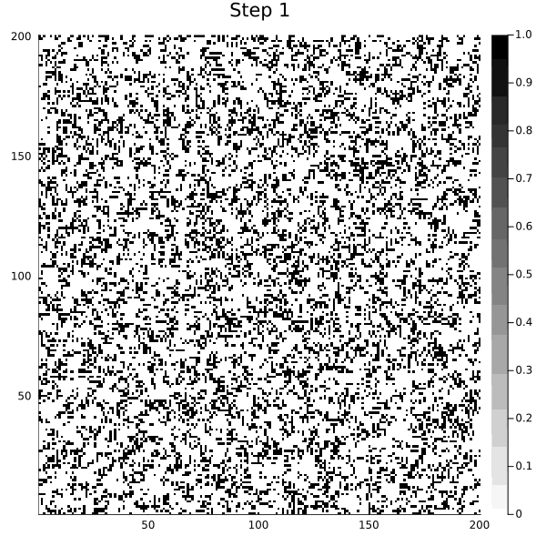
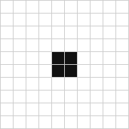
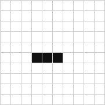
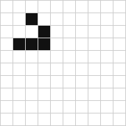
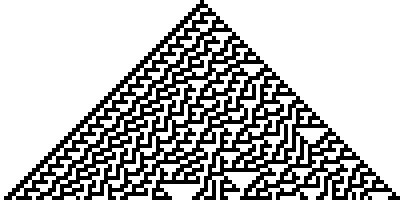
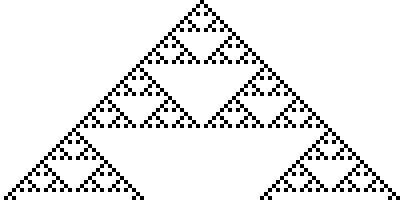
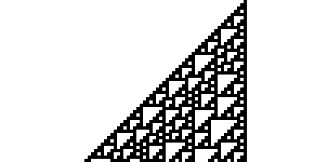

<div align="center">

# 🌱 Automata

**Cellular automata and Conway's Game of Life**<br>
an interactive Julia notebook ([Pluto.jl](https://plutojl.org)) and a collection of [NetLogo](https://ccl.northwestern.edu/netlogo/) models

[](https://julialang.org)
[](https://plutojl.org)
[](https://ccl.northwestern.edu/netlogo/)
[](LICENSE)



<sub>The first 200 generations of the Game of Life on a 200×200 grid with periodic boundaries, starting from randomly placed live cells. Animation generated by the notebook.</sub>

</div>

---

An exam project on **cellular automata**, also designed for science outreach. At its heart is an illustrated Pluto notebook, written in Italian, that:

- explains what cellular automata are, from von Neumann's question about self-reproducing machines to Conway and Wolfram;
- implements the two-dimensional **Game of Life** from scratch and renders it as an animation;
- provides an **interactive simulator of 1D elementary automata**, controlled with sliders and menus.

Alongside the notebook there are four **NetLogo models** that explore the same topics visually: the Game of Life, the 256 elementary rules, the Domany–Kinzel probabilistic automaton and fractal growth by aggregation (DLA).

## 📑 Contents

- [What's in the repository](#️-whats-in-the-repository)
- [Quick start](#-quick-start)
- [The Game of Life](#-the-game-of-life)
- [How it is implemented](#️-how-it-is-implemented)
- [The Pluto notebook: contents, installation and usage](#-the-pluto-notebook-contents-installation-and-usage)
- [The NetLogo models](#-the-netlogo-models)
- [Deep dive: elementary cellular automata](#-deep-dive-elementary-cellular-automata)
- [The `GameOfLife` Julia package (third-party)](#-the-gameoflife-julia-package-third-party)
- [Resources and bibliography](#-resources-and-bibliography)
- [License and credits](#-license-and-credits)

## 🗂️ What's in the repository

```text
automata/
├── notebooks/
│   ├── GOL_notebook.jl          ← the Pluto notebook, the heart of the project
│   ├── GOL_2D.gif               ← 2D Game of Life: 200×200 grid, 5000 generations
│   ├── gol_random.gif           ← 2D Game of Life on a small grid
│   └── my_life.gif              ← sample GIF produced by the 1D simulator
├── netlogo/
│   ├── gameoflife_rule1.nlogo   ← Game of Life
│   ├── CA 1D Elementary.nlogo   ← the 256 elementary rules (model by U. Wilensky)
│   ├── DK.nlogo                 ← Domany–Kinzel probabilistic automaton
│   └── DLA-simple.nlogo         ← diffusion-limited aggregation (DLA)
├── Conways-Game-of-Life/        ← third-party GameOfLife Julia package (MIT)
└── assets/                      ← images used in this README
```

> [!IMPORTANT]
> GitHub shows `GOL_notebook.jl` as plain text: the animations, formulas and interactive controls only appear when the notebook runs inside **Pluto**. Instructions below.

## 🚀 Quick start

**Pluto notebook** (step-by-step instructions in the [dedicated section](#-the-pluto-notebook-contents-installation-and-usage)):

1. Install Julia. On Linux and macOS run `curl -fsSL https://install.julialang.org | sh`; on Windows install Julia from the [Microsoft Store](https://apps.microsoft.com/detail/9NJNWW8PVKMN) or with `winget install --name Julia --id 9NJNWW8PVKMN -e -s msstore`.
2. Open a terminal in the repository folder, start `julia` and install Pluto (needed only once):
   ```julia
   import Pkg; Pkg.add("Pluto")
   ```
3. Launch Pluto directly on the notebook:
   ```julia
   import Pluto; Pluto.run(notebook = "notebooks/GOL_notebook.jl")
   ```

**NetLogo models**: install [NetLogo](https://ccl.northwestern.edu/netlogo/download.shtml), open a file from the [`netlogo/`](netlogo) folder and press `setup`, then `go`.

## 🧬 The Game of Life

The **Game of Life** (GOL) was invented by the mathematician John Horton Conway in 1970 and made famous by Martin Gardner's *Mathematical Games* column in *Scientific American*. It is a "zero-player game": you choose the initial configuration and then watch the system evolve on its own, with no further input.

### The world and the neighborhood

The world is a grid of square cells. Each cell has only two states, **alive** (1) or **dead** (0), and looks at the **8 cells around it**: the so-called *Moore neighborhood*.

<p align="center">
⬜⬜⬜⬜⬜<br>
⬜🟦🟦🟦⬜<br>
⬜🟦🟥🟦⬜<br>
⬜🟦🟦🟦⬜<br>
⬜⬜⬜⬜⬜<br>
<sub>🟥 the cell &nbsp;·&nbsp; 🟦 its 8 neighbors</sub>
</p>

### The rules

Time advances in discrete steps, the *generations*. At each step, for every cell you count the number $`H`$ of live neighbors and apply these rules:

| Current state | Live neighbors $`H`$ | Next state | Interpretation |
|:---:|:---:|:---:|---|
| alive | 2 or 3       | **alive** | survival |
| alive | 0 or 1       | dead      | isolation |
| alive | 4 to 8       | dead      | overcrowding |
| dead  | exactly 3    | **alive** | birth (reproduction) |
| dead  | other than 3 | dead      | nothing changes |

In compact form the rule is written **B3/S23**: *Birth* with 3 neighbors, *Survival* with 2 or 3. As a formula, with $`s_i(t) \in \{0,1\}`$ the state of cell $`i`$ at time $`t`$ and $`\mathcal{N}_i`$ its neighborhood:

```math
H_i(t) = \sum_{j \in \mathcal{N}_i} s_j(t),
\qquad
s_i(t+1) = \big[\,H_i(t) = 3\,\big] \;\lor\; \Big(\big[\,s_i(t) = 1\,\big] \land \big[\,H_i(t) = 2\,\big]\Big)
```

where $`[\,\cdot\,]`$ equals 1 if the condition is true and 0 otherwise.

A key detail: the rule is applied **to all cells at the same time**. Generation $`t+1`$ is computed entirely from generation $`t`$, as if every cell made its decision at the same instant. In code, this constraint requires a specific trick, explained below in [How it is implemented](#️-how-it-is-implemented).

### The Life bestiary

Such simple rules give rise to structures with very different behaviors. The three classic families:

| Still life | Oscillator | Spaceship |
|:---:|:---:|:---:|
|  |  |  |
| **Block**: every live cell has 3 live neighbors and no dead cell around it has 3, so it never changes | **Blinker**: alternates between a horizontal and a vertical bar (period 2) | **Glider**: after 4 generations it returns to its shape, shifted by one cell diagonally |

Starting from a random configuration, as in the animation at the top of this page, you see a **chaotic transient** in which structures are born, collide and destroy each other. In the end almost nothing but "ash" is left: blocks, beehives, blinkers and, sometimes, a few gliders roaming the grid.

### Why it is so interesting

- **Emergence.** No rule mentions "moving objects", and yet gliders exist. The global behavior emerges from purely local interactions.
- **Unpredictability.** In general there is no shortcut to find out how it will end: you have to simulate, generation after generation.
- **Universality.** Gliders can be used to carry signals and build logic gates. The *Gosper glider gun* (1970), which emits a glider every 30 generations, showed that a finite configuration can grow without limit. Putting these ingredients together, it was proved that Life can simulate a **universal computer** (Berlekamp, Conway and Guy, 1982). A remarkable consequence: deciding whether a configuration will eventually die out is an *undecidable* problem.

Life is also connected to the question the notebook starts from. Von Neumann had designed an automaton capable of reproducing itself, but it needed 29 states per cell. Conway was looking for much simpler rules, with only two states, that would still leave room for unpredictable behavior and universal constructors.

## ⚙️ How it is implemented

The same Game of Life is implemented twice in the project: in Julia, in the Pluto notebook, and in NetLogo. Both versions solve the same three problems: how to count the neighbors, what to do at the edges, and how to update all the cells "together".

### In the Pluto notebook (Julia)

Excerpt from [`notebooks/GOL_notebook.jl`](notebooks/GOL_notebook.jl), slightly simplified and with numbered comments:

```julia
function game_of_life_2D_gif(; N::Int=30, steps::Int=30)
    state = rand(0:1, N, N)                       # ① random initial state
    grid = Array(state)
    Ny, Nx = size(grid)

    anim = @animate for t in 1:steps
        new = zeros(Int, Ny, Nx)                  # ② grid for the next generation
        for y in 1:Ny, x in 1:Nx
            H = 0
            for dy in -1:1, dx in -1:1            # ③ Moore neighborhood
                if !(dy==0 && dx==0)
                    yy = mod1(y+dy, Ny)           # ④ periodic boundaries
                    xx = mod1(x+dx, Nx)
                    H += grid[yy, xx]
                end
            end
            new[y,x] = (H == 3 || (grid[y,x] == 1 && H == 2)) ? 1 : 0   # ⑤ B3/S23 rule
        end
        grid .= new                               # ② synchronous update

        heatmap(grid; c=:binary, clims=(0,1), size=(600,600), title="Step $t")   # ⑥ one frame
    end

    gif(anim, "GOL_2D.gif", fps=8)                # ⑥ assemble the GIF
end

game_of_life_2D_gif(N=200, steps=5000)
```

1. **Initial state.** `rand(0:1, N, N)` creates an N×N matrix of 0s and 1s in which each cell is alive with probability ½.
2. **Synchronous update.** The new values are written to a separate matrix, `new`, and never to `grid` while it is being read. Only when all cells have been computed does `grid .= new` replace the old generation with the new one. This is how the rule gets applied "in parallel".
3. **Neighborhood.** The two loops over `dy` and `dx` in `-1:1` visit the 3×3 square around the cell, skipping the cell itself (`dy == 0 && dx == 0`): what remains are the 8 Moore neighbors. Their sum is $`H`$.
4. **Periodic boundaries.** `mod1` wraps indices that fall outside the grid around to the opposite side: column `0` becomes column `Nx`, and column `Nx+1` becomes column `1`. The grid behaves like the surface of a doughnut (a *torus*): a glider that leaves on the right comes back in from the left.
5. **Rule.** A single line translates B3/S23: the cell is alive if it has 3 live neighbors, or if it was already alive and has 2.
6. **Visualization.** Each generation becomes a `heatmap` frame with the `:binary` palette (0 = white, 1 = black). The `@animate` macro from [Plots.jl](https://docs.juliaplots.org) collects the frames and `gif(...)` assembles them into a GIF at 8 frames per second, which Pluto displays directly in the notebook.

The computation itself is fast. Most of the time goes into drawing and encoding the frames: 5000 generations mean 5000 images.

### In NetLogo

In [`netlogo/gameoflife_rule1.nlogo`](netlogo/gameoflife_rule1.nlogo) each cell is a *patch* of the NetLogo world (white = alive, black = dead):

```netlogo
patches-own [n]

to go
  ask patches [
    set n count neighbors with [pcolor = white]      ;; 1) each patch counts its live neighbors
  ]
  ask patches [                                       ;; 2) only then do they all update
    set pcolor ifelse-value (pcolor = white and (n = 2 or n = 3)) or (pcolor = black and n = 3)
    [white][black]
  ]
end
```

Here the synchronous-update problem is even more visible, and a comment in the original code (in Italian) points it out explicitly: *"I have to update all the cells at the same time, so I use patches-own"*. `ask patches` makes the patches act **one at a time**, in random order. If each patch changed color immediately, the ones processed later would see a mix of old and new states, and you would get a different automaton. The solution is to split the step into two phases: first all patches store their number of live neighbors in the variable `n`, then they all update. It is the same idea as the `new` matrix in Julia: **first read everything, then write everything**.

### The implementations compared

| | Pluto notebook (Julia) | NetLogo `gameoflife_rule1` | `GameOfLife` package (third-party) |
|---|---|---|---|
| Grid | N×N (200×200 in the GIF) | 101×101 patches | 128×128 by default |
| Initial state | random, 50% live cells | random, density set by a slider (default 12%) | an R-pentomino in the center |
| Boundaries | periodic (torus) | periodic (the world "wraps around") | fixed: everything outside the grid is dead |
| Synchronous update | `new` matrix | two `ask patches` and the variable `n` | new matrix in `next` |
| Output | heatmap and animated GIF | real-time NetLogo view | Plots.jl window |

## 📓 The Pluto notebook: contents, installation and usage

[Pluto.jl](https://plutojl.org) is a notebook environment for Julia that runs in the browser and is **reactive**: when you change a value, for example by moving a slider, all the cells that depend on it are recomputed automatically. That is why the notebook is at its best inside Pluto, with the animations playing, the formulas typeset and the interactive controls working.

### What it contains

| Notebook section | What you will find |
|---|---|
| 🌱 **Cellular automata** (*Automi Cellulari*) | von Neumann's question about self-reproduction, the universal constructor, why study cellular automata |
| 🧬 **The Game of Life** | rules, Moore neighborhood, typical structures and the **animated 2D simulation** on a 200×200 grid |
| 🌀 **Cellular automata theory** (*Teoria degli Automi Cellulari*) | states and connections, totalistic rules, 1D elementary automata, Wolfram's notation and classes, resources |
| 🔹 **Interactive 1D implementation** (*Implementazione interattiva GOL 1D*) | the **elementary automata simulator** with sliders and menus |

The 1D simulator is built as a small pipeline of functions: `get_initial_state` creates the initial row, `create_rule_map` turns the rule number into a `(left, center, right) → new state` table, `evolve_grid` computes the evolution (again with periodic boundaries), and finally `plot_grid` or `giffe` draws it. The available controls:

| Control | Values | Meaning |
|---|---|---|
| `Nx` | 10 to 100 (default 50) | number of cells in the row |
| `state_type` | `Center` / `Random` | a single live cell in the center, or randomly placed live cells |
| `rule_number` | 0 to 255 (default 30) | elementary rule number |
| `steps` | 10 to 300 (default 60) | number of time steps, i.e. of rows |
| `gif_mode` | `Plot` / `GIF` | static image of the evolution, or an animated GIF saved as `my_life.gif` |

### 1. Install Julia

The recommended way is [juliaup](https://github.com/JuliaLang/juliaup), the official installer, which also lets you update Julia later.

- **Linux and macOS**: in a terminal, run
  ```sh
  curl -fsSL https://install.julialang.org | sh
  ```
- **Windows**: install Julia from the [Microsoft Store](https://apps.microsoft.com/detail/9NJNWW8PVKMN), or from the command prompt:
  ```sh
  winget install --name Julia --id 9NJNWW8PVKMN -e -s msstore
  ```

To check, open a **new** terminal, type `julia` and try computing `1 + 1`. Pluto works with Julia 1.10 to 1.13. The notebook was written with Julia 1.11 and also works with 1.13, the latest stable release.

### 2. Install Pluto

In the Julia terminal (the `julia>` prompt) run, just once:

```julia
import Pkg; Pkg.add("Pluto")
```

### 3. Download the project

On the repository's GitHub page, use the green **Code → Download ZIP** button and extract the archive. Alternatively, clone it with `git clone` followed by the address shown under the same button.

### 4. Start Pluto and open the notebook

```julia
import Pluto; Pluto.run()
```

Pluto opens your browser on its start page. If the browser does not open, copy the `http://localhost:1234/?secret=...` link printed in the terminal into the address bar. In the **Open a notebook** box, type the path of the `notebooks/GOL_notebook.jl` file (Pluto suggests paths as you type), then press **Open**. If your browser is set to another language, Pluto may show these labels translated.

Alternatively, you can open the notebook right away by starting Julia from the repository folder:

```julia
import Pluto; Pluto.run(notebook = "notebooks/GOL_notebook.jl")
```

> [!TIP]
> In the same **Open a notebook** box you can also paste the URL of the *Raw* version of `GOL_notebook.jl` from GitHub: Pluto downloads and opens it, with no need to download the repository. In this case Pluto starts in *Safe preview* mode: press **Run notebook code** to run it.

### 5. The first run takes patience

You don't need to install Plots, PlutoUI or other packages by hand. The notebook file contains the exact list of packages and their versions, and Pluto installs them by itself in an isolated environment. The first time, however, it has to download and precompile them. For reference, these are the times measured on the test computer with Julia 1.13 and Pluto 1.1:

| Operation | Approximate time |
|---|---|
| installing Pluto (`Pkg.add`, only once) | 3–4 minutes |
| first opening of the notebook (package download and precompilation) | about 5 minutes |
| later openings | less than a minute |
| 2D simulation with 5000 generations (at every opening) | about 3 extra minutes |

If you use a Julia version other than 1.11, Pluto updates the package versions stored in the notebook by itself. Warnings such as `Pkg operation failed… trying again` may appear in the terminal: this is normal, and the notebook file will be updated.

> [!WARNING]
> When it opens the notebook, Pluto runs **all** the cells, including `game_of_life_2D_gif(N=200, steps=5000)`, which draws 5000 frames and produces a GIF of about 24 MB: this is the slowest step. For shorter times, lower `steps` in that cell, for example to 300. The full GIF is already available anyway in [`notebooks/GOL_2D.gif`](notebooks/GOL_2D.gif).

The notebook saves the GIFs in its own folder: every run **overwrites** `GOL_2D.gif`, and `my_life.gif` too when the 1D simulator is in GIF mode.

### 6. How to use it

- Move the **sliders** and **menus** in the 1D section: the plot updates by itself.
- Use the **table of contents** on the right, generated by `PlutoUI.TableOfContents`, to jump from one section to another.
- Show or hide a cell's code with the **eye** icon next to it.
- Edit a cell and press **Shift + Enter** to run it: Pluto recomputes everything that depends on it.

<details>
<summary><b>Want to show the notebook to someone who doesn't have Julia?</b></summary>

<br>

With the notebook open in Pluto, the **Export** menu at the top right offers the **Static HTML** option: it produces a single HTML file, with text, plots and GIFs already computed, that opens in any browser. You can also publish it with [GitHub Pages](https://pages.github.com/). It is best to export it after reducing `steps` in the 2D simulation, otherwise the 24 MB GIF ends up inside the HTML.

</details>

## 🐢 The NetLogo models

[NetLogo](https://ccl.northwestern.edu/netlogo/) is a free agent-based modeling environment, widely used to teach complex systems.

**How to open them.** The models were saved with **NetLogo 6.4**: install it from the [download page](https://ccl.northwestern.edu/netlogo/download.shtml), then open the file with *File → Open*. **NetLogo 7** opens them too, but converts them to the new `.nlogox` format, which NetLogo 6.4 can no longer read: keep a copy of the original. To try them without installing anything you can use [NetLogo Web](https://netlogoweb.org/launch) with the *Upload a Model* button: the file stays in your browser. However, NetLogo Web does not yet support all the features of the desktop version.

All the models work the same way: adjust the sliders, press `setup` to create the initial state, then `go` to start (or stop) the simulation. The speed slider at the top of the window controls how fast the simulation runs.

### `gameoflife_rule1.nlogo`: the Game of Life

The NetLogo version of the Game of Life, described in the [In NetLogo](#in-netlogo) section: a 101×101 world with periodic boundaries, live cells in white.

- `density`: the fraction of live cells at the start (default 0.12).
- `setup` fills the world at random, `go` advances the generations.

**Try this:** change the initial density and watch how long the chaotic transient lasts and what is left at the end.

### `CA 1D Elementary.nlogo`: the 256 elementary rules

The *CA 1D Elementary* model from the NetLogo Models Library, by Uri Wilensky. It explores all 256 rules of the [elementary automata](#-deep-dive-elementary-cellular-automata): each row of the world is a generation, and time flows from top to bottom.

- `setup single` turns on a single cell in the center; `setup random` turns cells on at random, according to the `density` slider.
- The rule is chosen with the `rule` slider or with the 8 switches `OOO` … `III`, one for each three-cell configuration (`O` = off, `I` = on). The slider and the switches stay in sync.
- `show rules` displays the 8 transitions of the chosen rule graphically. `auto-continue?` restarts the simulation from the top when it reaches the bottom.

### `DK.nlogo`: the Domany–Kinzel automaton

A **probabilistic** one-dimensional cellular automaton, introduced by Domany and Kinzel in 1984. Here too each row is an instant of time. Each cell looks at two cells of the previous row, the one above and one diagonal neighbor, alternating left and right at every step to reproduce the diagonal lattice of the original model. Depending on how many of the two are active, it becomes active with a given probability:

| active cells among the two "parents" | probability of becoming active |
|:---:|:---:|
| 0 | `w`, spontaneous activation (very small, default 0.0001) |
| 1 | `p` |
| 2 | `q` |

- `setup` creates a random initial row with density `initial-density`; `setup-one` creates a single active cell.
- `go` runs the simulation indefinitely, `step` advances by one step, `go-once` draws a whole space-time diagram with `w = 0`.
- The **density** plot shows the fraction of active cells over time. **Distribution** shows the histogram of the densities recorded after a 200-step transient, and appears from step 400 on.

With `w = 0` the "all off" state is **absorbing**: once it is reached, the system never leaves it. As `p` and `q` vary, the model goes from a phase in which activity dies out to one in which it survives forever. This is a phase transition in the *directed percolation* universality class. **Try this** with `w = 0`:

- `q = p` is *site* directed percolation, with critical threshold $`p_c \approx 0.705`$;
- `q = p(2 − p)` is *bond* directed percolation, with threshold $`p_c \approx 0.645`$;
- `p = 1`, `q = 0` is a deterministic rule (the XOR of the two cells) that draws the Sierpinski triangle from a single cell.

### `DLA-simple.nlogo`: diffusion-limited aggregation

A model of fractal growth (Witten and Sander, 1981). In the center there is a yellow "seed". One particle at a time, shown in red, starts from a random point on the top or right edge and performs a random walk over the 4 adjacent cells. When it touches the aggregate it sticks to it, and the next particle starts. Particles stick more easily to the tips than to the inner gaps, so the aggregate grows into branching structures, similar to those of electrodeposition, mineral dendrites or Lichtenberg figures. The fractal dimension is about 1.7.

**Tip:** growth is slow, because there is only one particle at a time. Push the speed slider to the maximum, or untick *view updates* for a while.

## 📐 Deep dive: elementary cellular automata

**Elementary cellular automata** are the simplest possible ones: a row of cells with two states, in which each cell looks only at itself and its two neighbors. There are $`2^3 = 8`$ possible configurations of three cells, and a rule must say what happens in each of them, so there are $`2^8 = 256`$ possible rules.

**Wolfram's notation** gives each rule a name. List the 8 configurations from `111` to `000`, write the new state under each one, and read the resulting row as a binary number. For rule 30:

| configuration (left, center, right) | 111 | 110 | 101 | 100 | 011 | 010 | 001 | 000 |
|---|:---:|:---:|:---:|:---:|:---:|:---:|:---:|:---:|
| new state of the center cell | 0 | 0 | 0 | 1 | 1 | 1 | 1 | 0 |

and indeed $`00011110_2 = 16 + 8 + 4 + 2 = 30`$. Equivalently: the configuration $`(l, c, r)`$, read as the binary number $`b = 4l + 2c + r`$, is mapped to **bit $`b`$** of the rule number.

| Rule 30 | Rule 90 | Rule 110 |
|:---:|:---:|:---:|
|  |  |  |
| chaos from a single cell | the Sierpinski triangle: each cell becomes the XOR of its two neighbors | structures that move and interact: it is Turing-complete |

<sub>50 steps of evolution starting from a single live cell; time flows downward.</sub>

Many rules are "the same rule seen in a mirror" (swapping left and right) or "in negative" (swapping 0 and 1). Taking this into account, there are **88** truly different rules. Wolfram grouped them into **four classes** of behavior:

1. **Class 1**: evolve to a uniform state;
2. **Class 2**: settle into fixed or periodic structures;
3. **Class 3**: produce chaotic behavior, like rule 30;
4. **Class 4**: generate localized structures that interact in complex ways, like rule 110, whose computational universality was proved by Matthew Cook (2004).

All these rules can be explored with the notebook's 1D simulator and with the NetLogo model *CA 1D Elementary*.

## 📦 The `GameOfLife` Julia package (third-party)

The [`Conways-Game-of-Life/`](Conways-Game-of-Life) folder contains the **GameOfLife** Julia package by [Vasanth Mani Vasi](https://github.com/VasanthManiVasi/Conways-Game-of-Life), released under the MIT license and included here as a reference implementation. The notebook does not use it. Its code is organized in a more "library-like" way:

- `WorldState` represents the world and is *iterable*: each step of a `for` loop yields the next generation;
- `neighborhood` returns a *view* of the 3×3 block around the cell, clipped at the edges of the grid;
- `liferule` applies B3/S23 to a single cell, `next` to the whole grid;
- `simulate(max_days = …, initial_state = …, speed = …)` shows the evolution in a Plots.jl window.

Usage instructions are in its [README](Conways-Game-of-Life/README.md).

## 📚 Resources and bibliography

**Further reading**

- [F. Bagnoli's course material on cellular automata](https://teaching.complexworld.net/english/cellular-automata-2024)
- [Wikipedia: Conway's Game of Life](https://en.wikipedia.org/wiki/Conway%27s_Game_of_Life) and [Cellular automaton](https://en.wikipedia.org/wiki/Cellular_automaton)
- [ConwayLife.com](https://conwaylife.com/) and its [LifeWiki](https://conwaylife.com/wiki/), with thousands of cataloged patterns
- [Wolfram Demonstrations Project: Cellular Automata](https://demonstrations.wolfram.com/topic.html?topic=Cellular+Automata)
- [Introduction to Complexity](https://www.complexityexplorer.org/courses/185-introduction-to-complexity), Melanie Mitchell's course on Complexity Explorer, with a unit on cellular automata

**Tools**

- [Pluto.jl](https://plutojl.org) · [PlutoUI.jl](https://github.com/JuliaPluto/PlutoUI.jl) · [Plots.jl](https://docs.juliaplots.org) · [NetLogo](https://ccl.northwestern.edu/netlogo/) · [NetLogo Web](https://netlogoweb.org)

**Bibliography**

- M. Gardner, *Mathematical Games: The fantastic combinations of John Conway's new solitaire game "life"*, Scientific American 223 (4), 120–123 (1970).
- J. von Neumann, A. W. Burks (ed.), *Theory of Self-Reproducing Automata*, University of Illinois Press (1966).
- E. R. Berlekamp, J. H. Conway, R. K. Guy, *Winning Ways for your Mathematical Plays*, Academic Press (1982).
- S. Wolfram, *A New Kind of Science*, Wolfram Media (2002), [available online](https://www.wolframscience.com/nks/).
- M. Cook, *Universality in Elementary Cellular Automata*, Complex Systems 15, 1–40 (2004).
- E. Domany, W. Kinzel, *Equivalence of Cellular Automata to Ising Models and Directed Percolation*, Physical Review Letters 53, 311 (1984).
- T. A. Witten, L. M. Sander, *Diffusion-Limited Aggregation, a Kinetic Critical Phenomenon*, Physical Review Letters 47, 1400 (1981).

## 📝 License and credits

The original code and content of this repository (notebook, README, images in `assets/`) are released under the **MIT** license: see [`LICENSE`](LICENSE). The exceptions are:

- **`netlogo/CA 1D Elementary.nlogo`**: © 1998 Uri Wilensky, [CC BY-NC-SA 3.0 license](https://creativecommons.org/licenses/by-nc-sa/3.0/). It is the [*CA 1D Elementary*](http://ccl.northwestern.edu/netlogo/models/CA1DElementary) model from the NetLogo Models Library (Center for Connected Learning and Computer-Based Modeling, Northwestern University). The full copyright notice is in the model's *Info* tab.
- **`Conways-Game-of-Life/`**: © 2021 Vasanth Mani Vasi and contributors, MIT license: see [`Conways-Game-of-Life/LICENSE`](Conways-Game-of-Life/LICENSE).

The image of von Neumann's universal constructor shown in the notebook (Nobili and Pesavento's implementation) is loaded from [Wikimedia Commons](https://commons.wikimedia.org/wiki/File:Nobili_Pesavento_2reps.png).

To cite NetLogo: Wilensky, U. (1999). *NetLogo*. http://ccl.northwestern.edu/netlogo/. Center for Connected Learning and Computer-Based Modeling, Northwestern University, Evanston, IL.
